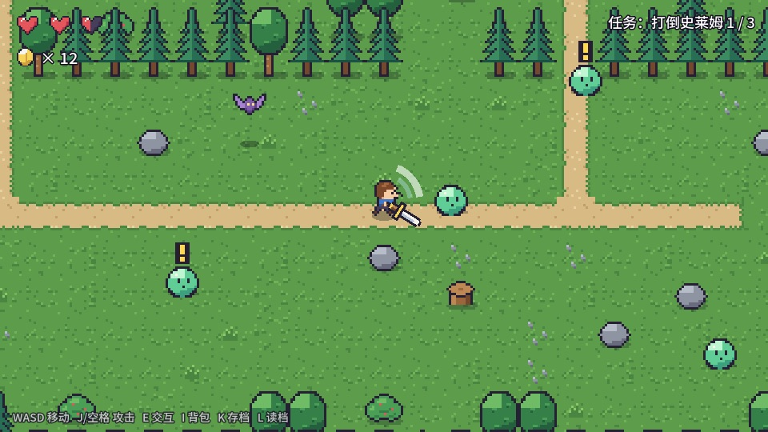
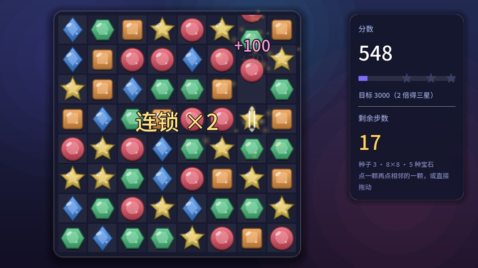
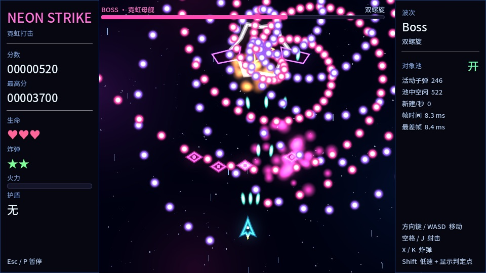
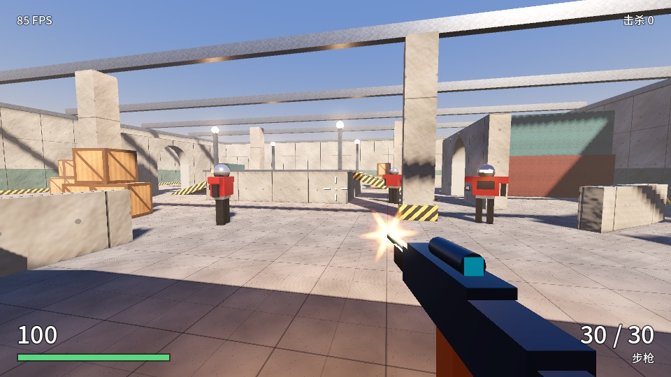
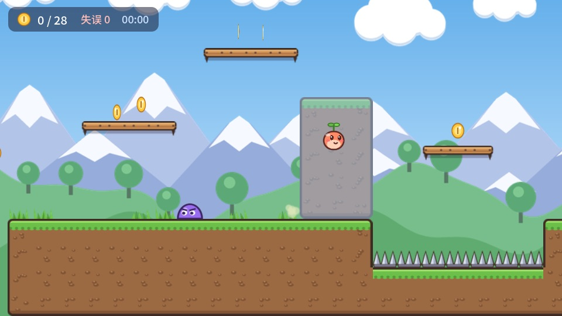
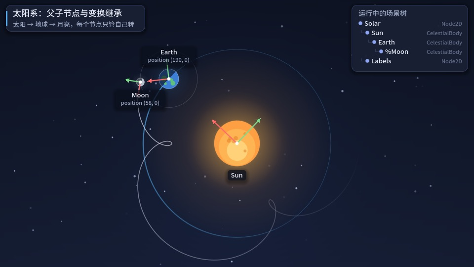

# Godot 4.7 互动教程 · 示例游戏工程

> **English** — Six complete sample games for **Godot 4.7 + GDScript**: a top-down RPG (map, dialogue, battle, state machine, save system), match-3, a space shooter (object pooling, collision layers, particles), a first-person shooter (controller, weapons, enemies, navigation), a platformer (jump feel: coyote time, jump buffering) and a basics demo. They accompany an 18-chapter interactive tutorial where every demo is **playable in the browser with live parameter sliders**: **https://gametech.byte888.com/godot/en/**. In-game text and code comments are in Chinese. MIT licensed.

《Godot 4.7 互动教程》的配套工程：从节点、信号、GDScript 讲到 RPG、三消、太空射击、FPS，6 个完整的示例游戏，全部用 **Godot 4.7 + GDScript**。

**👉 在线阅读（示例游戏能在浏览器里直接玩、拖滑块调参数）：https://gametech.byte888.com/godot/**

| | | |
|---|---|---|
|  |  |  |
| [俯视角 RPG](projects/rpg/) · [在线试玩](https://gametech.byte888.com/godot/demos/rpg.html) | [三消](projects/match3/) · [在线试玩](https://gametech.byte888.com/godot/demos/match3.html) | [太空射击](projects/shooter/) · [在线试玩](https://gametech.byte888.com/godot/demos/shooter.html) |
|  |  |  |
| [第一人称射击](projects/fps/) · [在线试玩](https://gametech.byte888.com/godot/demos/fps.html) | [平台跳跃](projects/platformer/) · [在线试玩](https://gametech.byte888.com/godot/demos/platformer.html) | [入门示例：太阳系 · 信号 · 生命周期](projects/basics/) · [在线试玩](https://gametech.byte888.com/godot/demos/basics.html) |

## 打开工程

1. 安装 [Godot 4.7.2](https://godotengine.org/download)（标准版即可，不需要 .NET 版）。
2. 打开 Godot → 项目管理器 →「导入」→ 选择 `projects/<示例名>/project.godot`。
3. 按 F5 运行。每个工程目录里的 README 有操作说明。

所有可调参数登记在各工程的 `params.json`，对应脚本里的 `@export` 变量。网页上调好的参数可以“下载当前参数”，放进工程后启动时会自动生效（由自动加载脚本 `tuning.gd` 负责）。

## 教程目录

| 部分 | 章节 |
|---|---|
| 入门 | 1 认识 Godot 4.7 · 2 节点与场景 · 3 GDScript 速成 · 4 信号与节点通信 · 5 向量、坐标与变换 |
| 2D 基础 | 6 角色移动与跳跃手感 · 7 动画、补间与手感 · 8 TileMapLayer、相机与关卡 |
| 2D 实战 | 9–10 RPG：地图、对话、战斗、状态机与存档 · 11–12 三消：网格、匹配算法、下落与连锁 · 13 太空射击：对象池、碰撞层与粒子 · 14 UI、音频与游戏流程 |
| 3D 实战 | 15 3D 基础：空间、相机、光照与材质 · 16–17 FPS：第一人称控制器、武器、敌人与导航 · 18 导出与发布：Web、桌面与移动端 |

## 许可

代码以 [MIT 许可证](LICENSE) 发布，可自由用于你的项目（含商业项目）。中文字体为 Noto Sans SC 子集，SIL Open Font License（见各工程 `fonts/OFL.txt`）。教程正文与配图版权归作者所有，仅供在线阅读。

作者：麦冬 · 411827633@163.com · [GameTech 技术专栏](https://gametech.byte888.com/) · 另见 [URP 渲染实战](https://github.com/MaedonDev/urp-render-cookbook)
